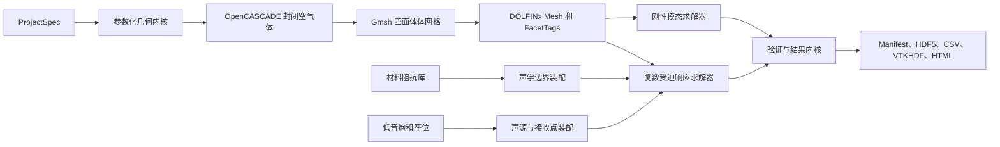

# 私人影院工程级 FEM 内核设计规格

- 日期：2026-08-08
- 状态：已批准并完成书面规格确认
- 目标产品：内部工程设计工具
- 目标频段：20–200 Hz
- 目标平台：Apple Silicon 本地计算

## 1. 目标与成功标准

本项目把现有 AcousticFEM 原型升级为可用于复杂私人影院内部方案比较的工程级低频有限元工具。首版必须支持：

1. 手工参数化构建真实封闭空气域，包括多边形平面、直顶或分区斜顶、地台、吊顶、梁柱和门窗边界贴片。
2. 使用真实三维四面体体网格，不得用输入几何的外包围盒代替真实空间。
3. 计算刚性边界固有模态，以及频率相关复声阻抗条件下的 20–200 Hz 受迫响应。
4. 支持多只低音炮，每只具有位置、增益、极性、延时和频率相关复数响应。
5. 输出各座位复声压、相位、峰谷、座位间均匀性及声源贡献；只有声源具备绝对体积速度标定时输出绝对 SPL，否则输出归一化相对声级。
6. 对几何、网格、求解残差、网格收敛、物理一致性和黄金算例执行失败关闭的工程门槛。
7. 每次运行可回溯至工程输入、材料来源、几何版本、网格、依赖版本、求解配置和验证证据。

完成标准不是“脚本无报错”，而是代表性私人影院案例能够生成 `Numerically Verified` 结果包，并且所有强制门槛均有机器可读证据。

## 2. 已确认范围

### 2.1 首版包含

- 参数化手工建模，不依赖 CAD、BIM 或扫描模型导入。
- 多边形平面、房高、分区斜顶、地台阶梯、吊顶、梁柱、关闭的门窗边界贴片。
- 单一连通封闭空气域。
- 刚性模态分析。
- 复数 Helmholtz 受迫响应。
- 复声阻抗、估算阻抗和刚性边界三级材料模型。
- 多低音炮复数激励。
- 座位耳位接收点。
- CLI、YAML 工程文件、可恢复运行、HTML 工程报告和机器可读结果包。
- 外部人工记录的现场测量对照，不在首版自动导入 REW。

### 2.2 首版明确不包含

- CAD、BIM、STL、OBJ 或激光扫描模型的生产级导入。
- 开放门洞及相邻空间耦合。
- 座椅、人体和小型设备的显式散射几何。
- 结构振动、固体传声、隔声和声固耦合。
- 扬声器非线性、失真、热压缩和最大声压能力。
- 200 Hz 以上的几何声学或混合求解。
- 全时域脉冲响应仿真。
- 自动优化器和自动给出低音炮最终设置。
- 图形化建模界面。
- 把倍频程吸声系数无条件宣称为真实复声阻抗。

## 3. 总体架构



模块必须通过稳定数据契约通信：

- `project_schema`：解析、规范化和验证工程输入。
- `geometry_kernel`：生成真实 BRep 空气体和稳定表面 ID。
- `mesh_kernel`：生成体网格、Physical Groups 和质量证据。
- `material_kernel`：加载、插值和分级阻抗数据。
- `source_kernel`：生成多声源复数激励与正则化空间载荷。
- `modal_solver`：计算刚性边界固有模态。
- `response_solver`：计算复数阻抗受迫响应。
- `receiver_kernel`：定位单元并评价座位及空间场结果。
- `verification_kernel`：执行六道门槛和可信度分类。
- `artifact_store`：保存不可变运行清单和结果包。
- `cli`：编排阶段命令，不包含声学公式或几何算法。

## 4. 工程坐标与单位

- 原点：银幕前墙左侧的室内完成面地坪。
- X 轴：从银幕墙指向后墙。
- Y 轴：从左墙指向右墙。
- Z 轴：从地面向顶面。
- 长度输入与内部存储统一为米。
- 时间统一为秒，频率统一为 Hz，声压统一为 Pa，声阻抗统一为 Pa·s/m。
- SPL 参考声压固定为 20 µPa。
- 工程文件允许显示单位字段，但规范化后的 `ProjectSpec` 不允许混合单位。

## 5. 核心数据模型

`project.yaml` 是用户维护的唯一工程入口。解析后生成规范化、带版本号且可哈希的 `ProjectSpec`。

```yaml
schema_version: "1.0"
project:
  id: cinema-demo
  units: m
geometry:
  footprint:
    - [0.0, 0.0]
    - [8.0, 0.0]
    - [8.0, 6.0]
    - [0.0, 6.0]
  floor_z: 0.0
  ceiling:
    default_height_m: 3.5
    slope_regions: []
  solids:
    risers: []
    soffits: []
    columns: []
  boundary_patches:
    doors: []
    windows: []
materials:
  catalog_file: materials/catalog.yaml
  default_boundary_material: rigid.default
  boundary_assignments: []
sources:
  - id: sub.front-left
    model: regularized_monopole
    position_m: [0.4, 0.8, 0.35]
    calibration: relative_complex_response
    response_file: sources/sub-front-left.csv
    gain_db: 0.0
    polarity: 1
    delay_ms: 0.0
    support_radius_m: 0.08
receivers:
  - id: seat.r1c1.ear
    position_m: [5.0, 2.5, 1.1]
analysis:
  frequency_min_hz: 20.0
  frequency_max_hz: 200.0
  initial_step_hz: 1.0
  refinement_step_hz: 0.25
  element_degree: 2
  mesh_profile: standard
```

每个工程对象必须具有稳定、唯一、可读的 ID：

- 空气域：`room.air`
- 边界：`wall.front`、`wall.left.01`、`floor.main`、`ceiling.slope.01`
- 实体：`riser.01`、`soffit.02`、`column.left.01`
- 门窗：`door.entry`、`window.left.01`
- 声源：`sub.front-left`
- 耳位：`seat.r2c3.ear`

ID 不依赖 Gmsh 的瞬时整数标签。几何内核维护工程 ID 到 CAD 实体、Physical Group 和 DOLFINx facet tag 的映射。

所有外表面必须获得材料分配。未显式分配的表面使用工程文件声明的 `default_boundary_material`；首版默认目录必须包含可追溯的 `rigid.default`，不得隐式采用未知吸声系数。

## 6. 参数化几何规则

### 6.1 空气域构造

1. 校验有序平面多边形不自交、方向一致且面积为正。
2. 根据直顶或分区斜顶生成封闭基础空气体。
3. 从基础空气体中扣除地台、吊顶、梁柱等实体。
4. 将门窗切分为墙面边界贴片；关闭的门窗不穿透空气域。
5. 对 OpenCASCADE 模型执行同步、布尔结果检查、体连通性检查和边界完整性检查。
6. 生成一个且仅一个 `room.air` 体。

几何容差默认为 `max(1×10⁻6 m, 1×10⁻7 × 房间包围盒对角线)`；小于十倍几何容差的特征禁止进入布尔和网格阶段。用户可以提高容差以处理大尺度模型，但降低容差必须产生 `Exploratory` 状态并记录理由。

### 6.2 几何硬门槛

以下任一条件失败即停止：

- 平面自交、重复顶点或零长度边。
- 布尔运算失败或产生多个非预期空气体。
- 空气域不封闭、体积非正或法线方向不一致。
- 存在零厚度、低于建模容差的狭长碎片或重复面。
- 外边界存在未映射工程 ID 的表面。
- 声源或耳位不在空气域内。
- 声源正则化支撑范围穿出空气域，或耳位距最近边界小于默认 0.05 m。耳位净距可在工程文件中提高但不能降低；贴近边界的工程评价必须改用专门的边界接收模型，首版不支持该模型。

系统不得在失败后自动切换到外包围盒或静默删除问题表面。

## 7. 材料与声学边界

### 7.1 证据等级

1. `MeasuredComplexImpedance`：频率相关复声阻抗 `Z(f)`，附测试方法、样品、安装条件、日期和来源。
2. `EstimatedImpedance`：只有吸声系数时，采用明确的局部反应和相位假设估算，记录转换公式和不确定性等级。
3. `RigidBoundary`：无合格数据时采用刚性边界，不虚构参数。

ISO 10534-2 法向入射阻抗数据与 ISO 354 混响室吸声数据属于不同证据类型，不能直接等同。

### 7.2 阻抗约束

- 固定采用 `p(x,t) = Re{p̂(x,ω)e^{iωt}}` 时间约定。局部反应阻抗边界使用 `∂p̂/∂n = -iωρ₀p̂/Z(ω)`；公式、代码和报告必须一致。
- 受迫响应使用频率相关 Robin/阻抗边界。
- 被动材料必须满足实部非负；不满足时视为输入错误，除非该对象被显式声明为主动边界，而首版不支持主动边界。
- 表格阻抗在求解频点间插值时分别处理实部和虚部，并记录插值方法。
- 超出材料数据频率范围时禁止无提示外推。默认策略 `error` 立即停止。唯一允许的首版替代策略是 `hold_endpoint`，只在距离最近端点不超过 5 Hz 时保持端点值，并强制把结果降为 `Exploratory`。

### 7.3 吸声系数估算限制

吸声系数只能约束反射能量，不能唯一确定反射相位或复声阻抗。首版允许在“局部反应、纯阻性、法向入射、反射系数相位为零”假设下生成估算阻抗。令 `r = sqrt(max(0, 1-α))`，归一化阻抗取 `z = (1+r)/(1-r)`；`α=0` 按刚性边界处理。结果必须标记 `EstimatedImpedance`，并且报告不得把该结果描述为材料实测阻抗。

## 8. 求解器设计

### 8.1 刚性模态求解器

- 求解刚性边界下的广义 Hermitian 特征值问题。
- 使用 SLEPc，显式记录问题类型、目标区间、收敛原因、残差和特征向量归一化方式。
- 输出固有频率、模态形状、简并关系、模态间距和模态密度。
- 模态基线用于解释几何共振，不包含真实频率相关材料损耗。
- 频率区间查询必须返回覆盖区间所需的模态集合，不能仅请求区间中点附近固定数量后误称为完整扫描。

### 8.2 复数受迫响应求解器

- 求解线性时谐复数 Helmholtz 问题。
- 初扫频段为 20–200 Hz，默认步长 1 Hz。
- 自动识别峰谷后，在相关区间使用 0.1–0.25 Hz 加密；工程文件选择具体加密步长。
- 每个频点记录矩阵规模、求解器、预条件器、迭代次数、收敛原因和真实残差。
- 同一频点的多只低音炮共享系统矩阵，采用多个右端项或等价批量求解。
- 对直接法和迭代法分别建立规模切换策略；策略由基准测试冻结，不由运行时静默猜测。

### 8.3 多低音炮模型

每只低音炮的复数源强由以下因素组成：

- 频率相关复数响应 `H(f)`。
- 线性增益。
- 极性。
- 延时产生的频率相关相位。
- 位置和正则化载荷支撑范围。

首版采用有限支撑范围的正则化单极子，不把点载荷直接绑定到单个网格节点。单极子不使用朝向参数；方向性辐射留给后续边界速度源模型。系统输出单只低音炮响应与组合响应，以验证线性叠加并支持工程比较。

源数据分为两种标定等级：

- `absolute_volume_velocity`：`H(f)` 的单位和参考条件可换算为复体积速度 `Q(f)`，允许输出绝对 Pa 和 dB SPL。
- `relative_complex_response`：只保留相对幅度与相位，结果只能输出归一化频响和座位间相对差异，不允许标为绝对 dB SPL。

`Numerically Verified` 描述数值求解可信度，不自动赋予绝对声压资格。Manifest 必须另存 `absolute_spl_eligible`；只有所有参与声源均具备有效的绝对体积速度标定时该值才为 `true`。

### 8.4 接收点求值

- 使用 DOLFINx 碰撞树或等价空间索引定位耳位所属单元。
- 在真实所属单元上评价有限元场。
- 禁止沿用当前实现中固定单元编号求值的方式。
- 输出原始复声压、幅值和相位；`absolute_spl_eligible=true` 时输出绝对 SPL，否则只输出归一化相对声级。
- 深零陷处保留复声压，避免仅用 dB 差异放大数值噪声。每个耳位低于该次响应最大幅值 40 dB 的频点定义为深零陷。

## 9. 网格策略

### 9.1 初始网格

在 200 Hz、声速 `c` 下定义最短波长 `λmin = c / 200`：

- P1 初始全局最大单元尺寸目标：`hmax ≤ λmin / 8`。
- P2 初始全局最大单元尺寸目标：`hmax ≤ λmin / 5`。
- 地台边缘、吊顶转折、窄通道、声源附近和高曲率区域使用局部尺寸场加密。

波长规则只负责生成初始网格，最终可信度由网格收敛决定。不得继续使用“每米固定十个单元”作为工程精度依据。

### 9.2 网格质量记录

每个网格必须记录：

- 节点数、单元数、自由度和分区数。
- `minDetJac`、`minSICN`、`gamma`、最小/最大边长和体积分布。
- 反转单元、零体积单元和未标记边界单元数量。
- 每个 Physical Group 的表面单元数量。
- 网格生成版本、选项、随机种子和耗时。

硬门槛要求全部 Jacobian 为正、无反转或零体积单元、100% 外边界具有标签。其他质量阈值在黄金算例阶段基于误差和稳定性冻结。

## 10. 工程可信门槛

以下阈值是本项目内部验收目标，不冒充行业标准。

### G1 几何

- 恰好一个预期连通空气域。
- 体积为正且封闭。
- 100% 外边界映射到稳定工程 ID。
- 所有声源和耳位通过空间合法性检查。

### G2 网格

- 无反转、零体积或未标记边界单元。
- 质量指标及其分布完整记录。

### G3 求解

- PETSc/SLEPc 收敛原因必须为正。
- 重新计算的真实相对残差目标不大于 `1×10⁻8`。
- NaN、Inf、最大迭代终止和预条件器失败均为硬失败。

### G4 网格收敛

- 至少比较 `h` 与 `0.75h` 两套网格；未通过时追加 `0.5h`。
- 匹配模态频率偏移目标不大于 0.5%。
- 座位 SPL 网格间中位差目标不大于 0.5 dB。
- 95% 有效频点的 SPL 差值目标不大于 1.0 dB。
- 主峰频率偏移目标不大于 0.5 Hz。
- 低于每个耳位响应最大幅值 40 dB 的深零陷单独评价归一化复声压误差，不纳入普通 dB 百分位。

这些响应阈值在黄金算例阶段复核后冻结；冻结前只能产生 `Exploratory` 结果。

### G5 物理一致性

- 多声源线性叠加一致。
- 交换声源和接收点后的互易性一致。
- 对称几何和对称激励产生对称结果。
- 被动阻抗边界的耗散非负。
- 频率扫描结果不存在未解释的不连续跳变。

### G6 基准

- 矩形刚性房间前 20 个解析模态。
- 复数 Helmholtz 制造解及预期阶数收敛。
- 一维管道或阻抗管解析反射算例。
- 单声源与多声源叠加黄金算例。
- 至少一个不规则私人影院独立参考算例。

## 11. 可信度状态

- `Exploratory`：计算完成，但一个或多个工程门槛未通过或阈值尚未冻结。只能用于趋势探索。
- `Numerically Verified`：G1–G6 全部通过，材料证据等级和不确定性已披露。可用于内部方案比较；是否具备绝对 SPL 资格由独立字段 `absolute_spl_eligible` 决定。
- `Project Calibrated`：在 `Numerically Verified` 基础上，另有人工记录的现场测量对照和适用范围说明。

状态只能升级，不能由用户手工强制覆盖。输入变化会使所有受影响的下游状态失效并重新计算。

## 12. CLI 工作流

首版提供以下阶段命令：

```text
acousticfem validate project.yaml
acousticfem geometry project.yaml
acousticfem mesh project.yaml --profile standard
acousticfem solve-modes project.yaml
acousticfem solve-response project.yaml
acousticfem verify project.yaml
acousticfem report project.yaml
acousticfem run project.yaml --profile engineering
```

组合命令内部仍按阶段执行。每个阶段只消费已验证的上游制品，并产生带哈希的不可变下游制品。

运行状态顺序为：

```text
DRAFT → GEOMETRY_VALID → MESH_VALID → SOLVED → NUMERICALLY_VERIFIED
```

任一阶段可以进入 `FAILED` 或 `CANCELLED`。安全中断后允许从最后一个有效制品继续。

## 13. 项目与结果文件

```text
project-root/
├── project.yaml
├── materials/
│   ├── catalog.yaml
│   └── impedance/*.csv
├── sources/
│   └── *.csv
├── notes/
│   └── measurement-comparison.md
└── runs/
    └── <run-id>/
        ├── manifest.json
        ├── normalized-project.json
        ├── geometry.brep
        ├── geometry-map.json
        ├── mesh.msh
        ├── mesh-quality.json
        ├── results.h5
        ├── tables/*.csv
        ├── fields.vtkhdf
        ├── verification.json
        ├── solver-log.jsonl
        └── report.html
```

`manifest.json` 至少记录：

- 所有规范化输入的内容哈希。
- 代码版本和依赖锁版本。
- 硬件、操作系统、MPI 规模和线程设置。
- 几何、网格、材料、声源、接收点和分析配置哈希。
- 各阶段开始时间、结束时间、状态和错误码。
- 可信度状态及每个门槛的证据文件路径。

## 14. 错误处理

错误使用稳定类型和工程对象 ID：

- `SchemaError`
- `GeometryTopologyError`
- `BoundaryTagError`
- `MeshGenerationError`
- `MeshQualityError`
- `MaterialEvidenceError`
- `SourcePlacementError`
- `SourceCalibrationError`
- `ReceiverPlacementError`
- `SolverDivergenceError`
- `VerificationGateError`

失败时生成诊断包，包含阶段、错误码、对象或单元 ID、频点、数值证据、复现实验配置和建议修复动作。部分结果不得输出成最终工程报告。

## 15. 性能边界

- 性能基准案例定义为：单一空气体不大于 350 m³、P2 自由度不大于 300,000、最多 4 只低音炮、12 个耳位、181 个初扫频点且自适应后总频点不超过 300。
- 上述基准案例的单网格标准设计运行目标为 Apple Silicon 本机 10–30 分钟。
- 标准运行包括模态分析和 20–200 Hz 自适应受迫响应。
- 完整工程验证包包含第二或第三套加密网格，预计为标准运行时间的 2–3 倍，并由后台队列执行。
- 报告必须记录硬件、自由度、单元数、频点数、声源数、线程/MPI 配置、求解器和阶段耗时。
- 缓存以输入哈希为键。只有依赖输入未变化时才允许复用几何、网格或结果。
- 性能优化不能降低残差、跳过频点或改变验证门槛而不记录。

## 16. 测试策略

### 16.1 单元测试

- Schema 版本、单位规范化和稳定哈希。
- 多边形方向、自交和退化检查。
- 工程 ID 与 Physical Group 映射。
- 材料证据等级、插值和被动性检查。
- 增益、极性、延时和复数声源合成。
- 绝对体积速度标定与 `absolute_spl_eligible` 判定。
- 声源与耳位空间定位。
- 可信度状态机和缓存失效规则。

### 16.2 集成测试

- 参数化房间到 BRep、Gmsh、DOLFINx 的完整链路。
- 所有外边界标签完整往返。
- 模态和受迫响应在同一网格契约上运行。
- 多右端项与逐声源求解一致。
- 取消、恢复和输入变更后的阶段失效。

### 16.3 数值回归测试

- 矩形房解析模态误差。
- 制造解收敛阶数。
- 一维阻抗边界反射。
- 对称性、互易性和线性叠加。
- 两级或三级网格收敛。
- 黄金私人影院结果的受控容差回归。

## 17. 现有代码迁移边界

保留现有矩形房示例作为 Phase 0 基线，但不直接把旧模块认定为新内核：

- 删除 `trimesh_to_fenicsx` 用外包围盒建箱体的生产路径。
- 修复或替换 `--repair` 参数与实现签名不一致的问题。
- 删除未生效的 `--resolution` 表象参数，改为显式网格配置。
- 替换固定单元编号的场评价方式。
- 把现有未接入求解器的材料 YAML 迁移到带证据等级的新材料契约。
- 统一 ParaView/VTKHDF 输出行为与文档，不再宣称默认生成实际未生成的文件。
- 旧 CLI 可以保留兼容入口，但内部必须调用新阶段编排器。

## 18. 六阶段交付

### Phase 0：基线冻结

- 保存现有矩形示例结果。
- 建立解析模态、CLI 当前行为和已知缺陷测试。
- 锁定首个开发环境和可复现命令。

完成标准：旧示例行为可复现，已知缺陷被测试明确捕获。

### Phase 1：真实几何与网格

- 实现 `ProjectSpec`、稳定 ID、OpenCASCADE 空气体、Gmsh 网格和 DOLFINx 标签导入。
- 实现几何与网格硬门槛。

完成标准：包含斜顶、地台、吊顶、梁柱和门窗贴片的参数化影院生成一个真实封闭体，全部外表面带标签，外包围盒替代路径不可用于工程运行。

### Phase 2：真实几何模态

- 重建刚性模态求解器、空间评价和模态匹配。
- 建立解析模态、制造解和网格收敛基准。

完成标准：模态残差和收敛目标通过，输出状态为 `MODAL_BENCHMARK_PASSED` 的模态基准包；完整 `Numerically Verified` 状态只能在 Phase 4 产生。

### Phase 3：多低音炮受迫响应

- 实现复数阻抗、多低音炮复数源强、多右端项、座位响应和自适应扫频。
- 建立一维阻抗、互易性、对称性和叠加测试。

完成标准：代表性影院输出每座位复声压、相位和声源贡献；具备绝对体积速度标定时额外输出绝对 SPL，否则输出归一化相对声级；所有受迫响应基准通过。

### Phase 4：工程验证与报告

- 实现 G1–G6、状态机、不可变 Manifest、诊断包和 HTML 报告。
- 冻结网格与响应收敛阈值。

完成标准：代表性影院生成完整 `Numerically Verified` 结果包，失败案例只能生成诊断包。

### Phase 5：内部项目试点

- 使用真实私人影院工程输入。
- 由工程师在外部对照现场测量并记录误差。
- 冻结适用范围、材料数据要求、性能基线和报告声明。

完成标准：至少一个真实项目形成可追溯人工校准记录；是否标为 `Project Calibrated` 由预先冻结的项目校准规则决定。

## 19. 参考依据与声明边界

- Gmsh OpenCASCADE、Physical Groups 和网格质量接口用于真实几何、标签与质量证据。
- DOLFINx Gmsh 接口用于导入网格、cell tags 和 facet tags。
- DOLFINx 复数 Helmholtz 示例证明技术栈支持复数有限元形式，但不等于本工具已经完成声学验证。
- SLEPc 用于广义特征值问题，PETSc 用于复数线性系统和收敛状态记录。
- ISO 10534-2:2023 用于区分法向吸声和复表面阻抗数据；ISO 354:2003 用于区分混响室吸声数据。
- 数值验证、网格收敛和实测校准必须分开陈述。`Numerically Verified` 不等于现场实测验证。

参考链接：

- https://gmsh.info/doc/texinfo/
- https://docs.fenicsproject.org/dolfinx/v0.10.0/python/generated/dolfinx.io.gmsh.html
- https://docs.fenicsproject.org/dolfinx/v0.10.0.post3/python/demos/demo_helmholtz.html
- https://slepc.upv.es/release/documentation/manual/eps.html
- https://petsc.org/release/manualpages/KSP/KSPConvergedReason/
- https://www.iso.org/standard/81294.html
- https://www.iso.org/standard/34545.html
- https://www.grc.nasa.gov/www/wind/valid/tutorial/tutorial.html
